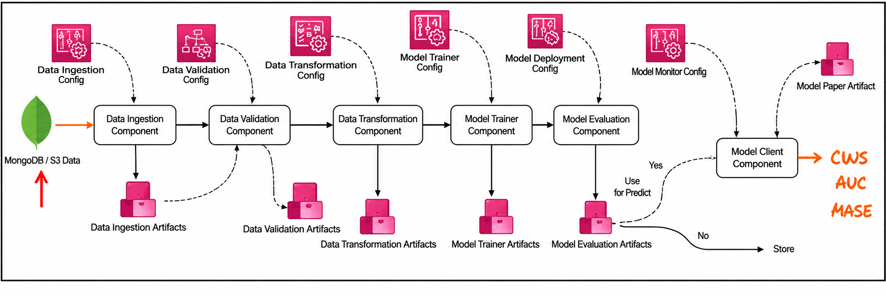
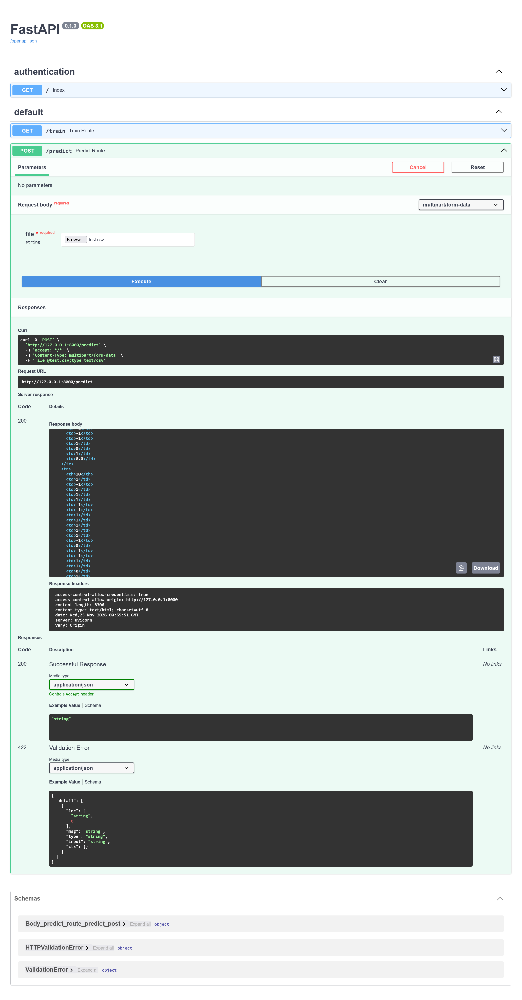

<div align="justify">


# Network-Security / Website-phishing-detection

--- 

## Project Overview

This project implements a complete Machine Learning Operations (MLOps) pipeline for phishing website detection. The system automates the entire machine learning lifecycle, including data ingestion, validation, transformation, model training, experiment tracking, cloud artifact management, deployment, and batch prediction.
The objective is to classify websites as legitimate or phishing using engineered URL and website security features. The project follows industry-standard MLOps practices and leverages MongoDB Atlas, MLflow, DagsHub, Docker, AWS Cloud Services, and FastAPI for production-ready deployment.


## Objective

A phishing website is a common social engineering method that mimics trustful uniform resource locators (URLs) and webpages. The objective of this project is to train machine learning models and deep neural nets on the dataset created to predict phishing websites. Both phishing and benign URLs of websites are gathered to form a dataset and from them required URL and website content-based features are extracted. The performance level of each model is measures and compared.

## Data Collection

To perform phishing website classification, the Phishing Websites Data Set of the UCI machine learning repository is used. It contains 31 columns that have 30 features and a target variable which has the label. The target variable has two classes denoting whether the website is legitimate or phishing. The dataset contains data of 11,055 legitimate and phishing.

- Dataset: https://github.com/MannShrestha/Branching-Data/blob/main/phisingData.csv

---

# Project Workflow



--- 

<div style="display: flex; overflow-x: auto; gap: 16px; padding-bottom: 10px;">
  
</div>

# End-to-End Machine Learning Pipeline

## 1. Data Collection and Centralized Storage

The project begins with a phishing website dataset containing over thirty website and URL-based security features. These attributes describe various characteristics of a website, such as URL behavior, SSL status, domain information, web traffic indicators, Google indexing status, and other phishing-related signals.

Instead of directly training from a local file, the dataset is uploaded into MongoDB Atlas. This approach simulates a production environment where data is stored in a centralized database rather than local storage. Using MongoDB provides scalability, remote accessibility, and a clear separation between data engineering and machine learning workflows.

At this stage, the dataset serves as the primary data source for all subsequent machine learning operations.

---

## 2. Data Ingestion

The Data Ingestion component acts as the entry point of the machine learning pipeline.

The component establishes a connection with MongoDB Atlas and retrieves all records from the database collection. The retrieved records are converted into a structured pandas DataFrame and stored within a feature store to maintain reproducibility. Keeping a feature store allows the project to preserve the exact version of the data used for a particular experiment or model training run.

After loading the dataset, the component performs train-test splitting. The training dataset is used to learn patterns, while the testing dataset is reserved exclusively for model evaluation. This separation helps estimate how the model will perform on unseen data.

The generated datasets are stored as artifacts so that every pipeline run can be traced, reproduced, and audited later.

---

## 3. Data Validation

The purpose of the Data Validation stage is to ensure that the incoming data satisfies all predefined quality requirements before any preprocessing or model training takes place.

The validation process compares the incoming dataset against a predefined schema. This schema defines expected feature names, data types, and dataset structure.

Several quality checks are performed:

- Verification of all expected columns
- Detection of unexpected or missing features
- Structure consistency checks
- Dataset integrity verification
- Training and testing data drift analysis

Data drift detection is particularly important because machine learning models assume that future data follows patterns similar to training data. If the new data significantly differs from historical data, model performance may decline. By generating data drift reports, the system helps identify changes in data distribution before deployment.

This stage ensures that only high-quality data proceeds to model training.

---

## 4. Data Transformation

Raw datasets are rarely suitable for direct machine learning training. Therefore, the Data Transformation stage is responsible for preparing the data for model development.

One of the most important operations performed in this stage is missing value handling using a K-Nearest Neighbors (KNN) imputation strategy. Missing values can negatively impact machine learning algorithms, so they are replaced using patterns learned from neighboring data points.

After imputation, the datasets are transformed into machine-learning-friendly numerical arrays. The entire preprocessing workflow is encapsulated inside a reusable preprocessing object.

Saving the preprocessing pipeline is critical because prediction data must undergo exactly the same transformations used during training. Without this consistency, prediction results would become unreliable.

The transformed datasets and preprocessing pipeline are stored as artifacts and passed to the next stage of the workflow.

---

## 5. Model Training

The Model Training stage is responsible for identifying the most suitable machine learning algorithm for detecting phishing websites.

Instead of relying on a single algorithm, the pipeline evaluates multiple machine learning models and automatically selects the best-performing candidate.

The following algorithms are trained and compared:

### Random Forest Classifier

Random Forest is an ensemble learning method that combines multiple decision trees. It is highly effective for tabular datasets and provides strong generalization performance while reducing overfitting through ensemble voting.

### Decision Tree Classifier

Decision Trees create hierarchical rule-based structures that are easily interpretable. They provide a useful baseline and are capable of capturing non-linear relationships within the dataset.

### Gradient Boosting Classifier

Gradient Boosting builds trees sequentially, where each new tree attempts to correct errors made by previous trees. This often leads to high predictive performance and strong classification accuracy.

### Logistic Regression

Logistic Regression serves as a statistical baseline model. It is efficient, interpretable, and provides insights into how well the dataset can be separated through a linear decision boundary.

### AdaBoost Classifier

AdaBoost focuses on difficult-to-classify observations by assigning higher importance to previously misclassified samples. This often improves classification performance in challenging datasets.

By evaluating multiple algorithms instead of relying on a single model, the pipeline increases the likelihood of selecting the most effective phishing detection solution.

---

## 6. Hyperparameter Optimization

Merely training a model with default settings rarely leads to optimal performance.

To address this challenge, the project uses GridSearchCV to automatically search across multiple hyperparameter combinations for each algorithm.

Examples of optimized parameters include:

- Number of decision trees
- Learning rates
- Sampling ratios
- Splitting criteria
- Ensemble sizes

Every candidate model is trained and validated across multiple parameter combinations, and the configuration producing the highest performance score is selected.

This automated optimization process improves model accuracy and ensures the final model performs at its full potential.

---

## 7. Model Evaluation

Once the training process is complete, all candidate models are evaluated using classification metrics specifically suited for phishing detection problems.

### Precision

Measures how many websites predicted as phishing were actually phishing websites.

### Recall

Measures the model's ability to identify all phishing websites present in the dataset.

### F1-Score

Provides a balanced measure of precision and recall, making it particularly important for cybersecurity classification tasks.

Since phishing detection involves minimizing both false positives and false negatives, these metrics provide a comprehensive assessment of model quality.

The best-performing model is automatically selected and promoted to production.

---

## 8. Experiment Tracking with MLflow and DagsHub

Machine learning experiments often involve multiple training runs, parameter combinations, and model versions.

To ensure proper experiment management, the project integrates MLflow and DagsHub.

During every training run, the pipeline automatically records:

- Model performance metrics
- Hyperparameter configurations
- Training runs
- Artifacts
- Model versions

Experiment tracking provides complete traceability and allows developers to compare different model versions and reproduce historical results when necessary.

This represents an important MLOps best practice for professional machine learning systems.

---

## 9. Model Packaging

After selecting the best-performing algorithm, the model is packaged together with the preprocessing pipeline.

This combined package ensures that future prediction requests use exactly the same preprocessing logic that was applied during training.

By coupling preprocessing and prediction logic together, the project eliminates inconsistencies between training and inference environments.

The packaged model forms the final production artifact.

---

## 10. Artifact Storage and Cloud Synchronization

The project generates numerous artifacts throughout execution.

These include:

- Training datasets
- Testing datasets
- Validation reports
- Drift reports
- Transformed datasets
- Preprocessing objects
- Trained models
- Experiment outputs

To provide centralized storage and backup, all artifacts are synchronized with Amazon S3-compatible storage.

Cloud storage enables:

- Artifact versioning
- Disaster recovery
- Reproducibility
- Easy deployment access
- Centralized model management

This ensures that no important training outputs are lost between pipeline executions.

---

# End-to-End Deployment Pipeline

## Docker Containerization

Once model development is complete, the entire application is containerized using Docker.

The Docker image contains:

- FastAPI application
- Machine learning model
- Preprocessing pipeline
- Python dependencies
- Configuration files

Containerization guarantees that the application behaves consistently across development, testing, and production environments.

---

## AWS Identity and Access Management (IAM)

IAM roles and policies are configured to allow secure communication between AWS services.

The IAM configuration grants permissions for:

- 1. AmazonEC2ContainerRegistryFullAccess
- 2. AmazonEC2FullAccess

- EC2 to pull images from ECR
- EC2 to access model artifacts stored in S3
- Secure interaction among AWS resources

Using IAM follows cloud security best practices by avoiding hardcoded credentials.

---

## Amazon Elastic Container Registry (ECR)

The generated Docker image is pushed to Amazon ECR, which acts as a centralized container repository.

ECR provides:

- Container image versioning
- Secure image storage
- Automated deployment support
- Integration with AWS infrastructure

Every deployment version is stored and can be pulled whenever required.

---


## Amazon EC2 Deployment

An EC2 instance serves as the production inference server.

The deployment process consists of:

1. Launching an EC2 instance.
2. Authenticating the instance using IAM roles.
3. Pulling the latest Docker image from ECR.
4. Running the FastAPI application inside a Docker container.
5. Exposing the application through public endpoints.

This infrastructure provides a scalable environment capable of serving prediction requests from users.

---

## FastAPI Model Serving

The deployed FastAPI application exposes REST APIs that provide both training and prediction capabilities.

The training endpoint allows retraining the complete pipeline whenever new data becomes available.

The prediction endpoint enables users to upload CSV files and receive batch predictions.

FastAPI serves as the bridge between machine learning models and end users.

---

## Batch Prediction Workflow

When prediction requests arrive, the system follows a standardized workflow:

1. User uploads a CSV file.
2. FastAPI receives the request.
3. Saved preprocessing pipeline is loaded.
4. Saved trained model is loaded.
5. Input data is transformed.
6. Predictions are generated.
7. Results are returned to the user.
8. Prediction outputs are stored for further analysis.

This guarantees that all incoming data is processed consistently and reliably.

---

# Complete End-to-End Architecture

```python
Dataset
   │
   ▼
MongoDB Atlas
   │
   ▼
Data Ingestion
   │
   ▼
Data Validation
   │
   ▼
Data Transformation
(KNN Imputation)
   │
   ▼
Multi-Model Training
(Random Forest, Decision Tree,
Gradient Boosting,
Logistic Regression,
AdaBoost)
   │
   ▼
GridSearchCV Optimization
   │
   ▼
Model Evaluation
(F1, Precision, Recall)
   │
   ▼
Best Model Selection
   │
   ▼
MLflow + DagsHub Tracking
   │
   ▼
Model Packaging
   │
   ▼
Amazon S3 Storage
   │
   ▼
Docker Containerization
   │
   ▼
Amazon ECR
   │
   ▼
Amazon EC2
   │
   ▼
FastAPI Application
   │
   ▼
Batch Prediction System
```


## Git Commands
```bash
git add .

git commit -m "Updated"

git push origin main
```

## How to run?
```bash
conda create -n network python==3.12 -y
```
```bash
conda activate network
```
```bash
pip install -r requirements.txt
```

# Workflow:

```bash
1. constants
2. entity
3. components
4. pipeline
5. Main file
```

## Export the environment variable
```bash
export MONGODB_URL="mongodb+srv://<username>:<password>...."

export AWS_ACCESS_KEY_ID=<AWS_ACCESS_KEY_ID>

export AWS_SECRET_ACCESS_KEY=<AWS_SECRET_ACCESS_KEY>

```

## **AWS-CICD-Deployment-with-Github-Actions**

**1. Login to AWS console.**

**2. Create IAM user for deployment**

```python
#with specific access

1. EC2 access : It is virtual machine

2. ECR: Elastic Container registry to save your docker image in aws


#Description: About the deployment

1. Build docker image of the source code

2. Push your docker image to ECR

3. Launch Your EC2 

4. Pull Your image from ECR in EC2

5. Lauch your docker image in EC2

#Policy:

1. AmazonEC2ContainerRegistryFullAccess

2. AmazonEC2FullAccess
```

**3. Create ECR repo to store/save docker image**

```bash
Save the URI: <566373416292.dkr.ecr.us-east-1.amazonaws.com>/<repo-name>
```

**4. Create EC2 machine (Ubuntu)**

**5. Open EC2 and Install docker in EC2 Machine:**

```python
#optinal

sudo apt-get update -y

sudo apt-get upgrade

#required

curl -fsSL https://get.docker.com -o get-docker.sh

sudo sh get-docker.sh

sudo usermod -aG docker ubuntu

newgrp docker
```
**6. Configure EC2 as self-hosted runner:**

```bash
setting>actions>runner>new self hosted runner> choose os> then run command one by one
```
**7. Setup github secrets:**
```python
AWS_ACCESS_KEY_ID=

AWS_SECRET_ACCESS_KEY=

AWS_REGION = us-east-1

AWS_ECR_LOGIN_URI = demo>>  566373416292.dkr.ecr.ap-south-1.amazonaws.com

ECR_REPOSITORY_NAME = kidney
```


